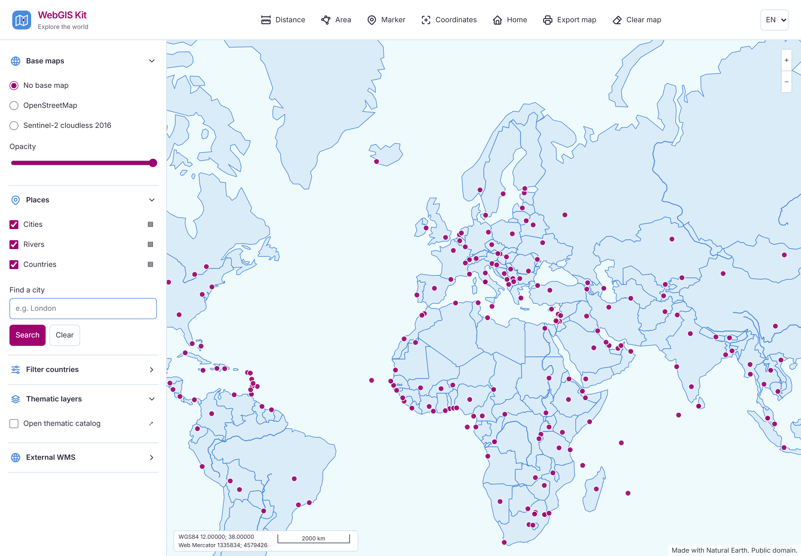

# WebGIS Kit

Шаблон за уеб карта с OpenLayers и Vite. Настройва се чрез JSON, собствени данни, тема и plugin-и в `app/`. Демото показва населени места, реки и държави от Natural Earth без необходимост от GeoServer.

## Кажи на агента

> Използвай webgis skill-а и ми направи 2D уеб ГИС с моите данни.

Инсталирай за проекта с `npx skills add Nikolai-prog1/webgis-kit --skill webgis`. В Claude Code: `/plugin marketplace add Nikolai-prog1/webgis-kit`, после `/plugin install webgis@webgis-kit`. Може да се използва и локално копие. Глобално инсталиране не е необходимо.

Skill-ът започва и от празна/непроектна папка: създава проект от конкретна версия, избира GeoJSON без сървър, готови сървъри, Windows portable стек или Docker и импортира GeoJSON, GeoPackage и Shapefile. Добавя слоеве, identify, таблици, търсене и филтри, настройва заглавие, езици и лого и проверява картата. Виж [нов проект](skills/webgis/references/new-project.md), [импорт](docs/import.md) и [режими на стека](docs/stack.md).



## Пускане

Нужни са Node 24+ и npm 11+. Изпълни от папката, в която искаш проекта:

```sh
git clone https://github.com/Nikolai-prog1/webgis-kit.git
npm --prefix webgis-kit ci --include=dev
npm --prefix webgis-kit run dev
```

Отвори показания локален адрес. `app/` е празен стартов шаблон с OpenStreetMap. Добави файлове с `npm run import -- <файловете>`. За запазеното Natural Earth демо задай `WEBGIS_APP_DIR=examples/configs/demo`; без външна базова карта то работи само с локалните данни, шрифтове и икони.

## Настройка

Редактирай само `app/**` и локалния `.env`. Основният файл е `app/static/config/app.json`; каталозите са в `config/catalogs/`, данните — в `data/`, логото — в `brand/`. Пътищата в JSON са спрямо `app/static/`. След промяна изпълни `npm run validate` и провери в браузъра. Външна инстанция се избира с `WEBGIS_APP_DIR`.

Получаваш базови карти, слоеве и каталози, identify, търсене, филтри, таблици/CSV, измерване, маркери, координати, PNG/печат с легенда и attribution, EN/BG и мобилен интерфейс. Примерите са в [examples/configs](examples/configs); пълният [справочник](skills/webgis/references/config-reference.md) се генерира от схемите. За агент използвай [AGENTS.md](AGENTS.md) и [skill-а](skills/webgis/SKILL.md), или `npx skills add Nikolai-prog1/webgis-kit`.

`npm run build` създава `dist/`; виж [внедряване](docs/deployment.md). JSON конфигурацията се редактира и след build. Proxy настройките на Vite трябва да се заменят с настройки на production сървъра. Сървърните права не се заменят от frontend вход. Ядрото се обновява чрез `npm run update-core -- <tag>`; [правила за обновяване](docs/upgrading.md).

`npm run smoke` изгражда временен preview, проверява данните/WMS/WFS и зареждането в Chromium. Ако браузърът не е наличен, отчита само HTTP проверки и оставя визуалната проверка за човека. `npm run stack -- down` спира управляваните локални услуги, като запазва данните; външните сървъри остават работещи. Паролите са само в игнорирания `.env`.

MIT. Данните Natural Earth са обществено достояние; [лицензи и благодарности](NOTICE.md). Created by Nikolai Ivanov (@Nikolai-prog1).
