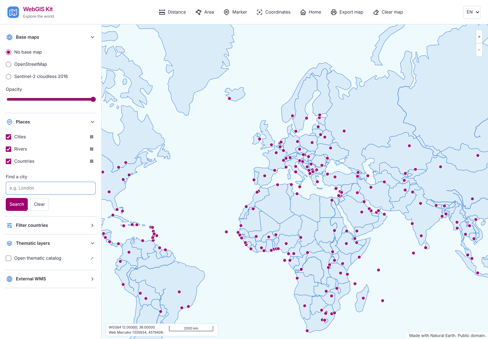

# WebGIS Kit

A configurable web map for GIS specialists and developers. Edit one instance directory to connect local GeoJSON, WMS or WFS data. The core uses vanilla JavaScript, OpenLayers and Vite; no UI framework or backend is required for the demo.

## Tell an agent

> Use the webgis skill to create a 2D web GIS from my data.

Install the skill for your project with `npx skills add Nikolai-prog1/webgis-kit --skill webgis`, or in Claude Code run `/plugin marketplace add Nikolai-prog1/webgis-kit` and `/plugin install webgis@webgis-kit`. A local checkout can also be used as the source. No global installation is needed.

The skill works from an empty/nonproject folder: it bootstraps a versioned project, selects local GeoJSON, existing servers, a Windows portable stack or Docker, imports GeoJSON/GeoPackage/Shapefile, and adds layers, identify, tables, search and filters. It applies your title/languages/logo and verifies the map. See [new project](skills/webgis/references/new-project.md), [import](docs/import.md) and [stack modes](docs/stack.md). Existing maps remain editable through their instance JSON/plugins.



## Quick start

Use Node 24+ and npm 11+. From the directory where you want the checkout:

```sh
git clone https://github.com/Nikolai-prog1/webgis-kit.git
npm --prefix webgis-kit ci --include=dev
npm --prefix webgis-kit run dev
```

Open the printed local URL. `app/` starts with an empty map and OpenStreetMap basemap. Import your files with `npm run import -- <files>`. The retained Natural Earth demo is selected with `WEBGIS_APP_DIR=examples/configs/demo`; its local vectors/fonts/icons work without a basemap network connection. See [Bulgarian instructions](README.bg.md).

## Included

Base maps and opacity; layer lists; lazy catalogs with exclusive groups, legends and scale hints; identify and safe popups; attribute search, filters and paged tables with CSV; movable/minimizable panels; distance/area measurement; markers; coordinate entry; home/clear; PNG/print sheets with attribution; English/Bulgarian UI and responsive layout. Local, GeoServer CQL and OGC FES query adapters share one API. The demo includes custom popup and thematic-style plugins.

## Configure your instance

Edit only `app/**` and ignored environment files. `app/static/config/app.json` is loaded at runtime; catalogs, local data and brand assets live under `app/static/`. Plugins and theme are `app/plugins/` and `app/theme.css`. An external instance uses the same structure and is selected through `WEBGIS_APP_DIR`.

This complete small configuration works after copying `examples/configs/demo/static/data/cities.geojson` into `app/static/data/`:

```json
{
  "version": 1,
  "app": {
    "id": "my-map",
    "title": "My map",
    "locale": "en",
    "locales": ["en", "bg"]
  },
  "map": { "center": [12, 38], "zoom": 3 },
  "basemaps": { "default": "none", "allowNone": true, "items": [] },
  "layers": [
    {
      "id": "places",
      "title": "Places",
      "geometry": "point",
      "source": { "type": "geojson", "url": "data/cities.geojson" },
      "visible": true
    }
  ],
  "sidebar": [
    {
      "id": "data",
      "title": "Data",
      "open": true,
      "blocks": [{ "type": "layer-list", "layers": ["places"] }]
    }
  ],
  "toolbar": ["home", "print", "clear"]
}
```

Run `npm run validate` after editing. Read [configuration](docs/configuration.md), the [generated reference](skills/webgis/references/config-reference.md), and the complete [example instances](examples/configs). Everything outside the instance is core and is managed by [update-core](docs/upgrading.md).

## Work with an agent

Start with [AGENTS.md](AGENTS.md) and [the WebGIS skill](skills/webgis/SKILL.md). Install with `npx skills add Nikolai-prog1/webgis-kit`. Claude Code users can run `/plugin marketplace add Nikolai-prog1/webgis-kit`, then `/plugin install webgis@webgis-kit`. Manifest/discovery formats were checked against their official documentation; installation into every agent product is not an integration guarantee.

The required cycle is edit → validate → dev server → browser verification. `npm run smoke` builds a temporary preview and checks the configured data/services and Chromium; without Chromium it reports HTTP-only verification. Use instance plugins for behavior that JSON cannot express; [plugin API](docs/plugins.md).

## Build, deploy and maintain

`npm run build` produces `dist/`; [deployment recipes](docs/deployment.md) cover static hosting, Nginx, IIS and temporary preview. Edit deployed `config/app.json` without rebuilding; plugin/theme changes need a build. Vite proxy configuration is for development/preview, so configure a production reverse proxy separately. Backend authorization remains the server's responsibility.

`npm run check` runs lint, checkJs, unit/Python tests, config validation, build, Chromium scenarios and privacy scanning. `npm run screenshots` refreshes documentation images at double density. Optional [QGIS/GeoServer tools](tools/qgis-to-geoserver/README.md) export SLD/catalogs and produce reviewable publication plans. The [container example](examples/geoserver-stack/README.md) is provided but not verified with Docker here.

## License and credits

MIT; see [LICENSE](LICENSE) and [third-party notices](NOTICE.md). Natural Earth data is public domain. Respect each basemap provider's attribution and service policy. Created by Nikolai Ivanov (@Nikolai-prog1).
