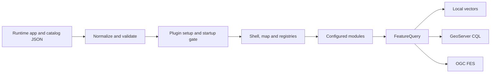

# Architecture

The core owns application startup, rendering, UI infrastructure, data adapters and modules. An instance owns JSON, private proxy targets, assets, plugins and CSS tokens. Core imports the selected instance only through `@app/plugins` and `@app/theme.css`; Vite serves the selected `static/` as its public directory.

Plugins register before `config:loaded`; that hook can extend configuration. The normalized configuration is then frozen. `app:beforeStart` is awaited before the shell; `app:ready` runs after modules. Layer definitions and mutable OpenLayers objects are separate registry entries. Catalog sources are created only when needed. Basemaps use z-index 0–9, catalog geometry bands start at 100, standalone layers at 1000; label overlays add 2000, query/table/measurement/marker auxiliaries use higher bands.

A single click router runs priority handlers until consumed. Tool exclusivity prevents identify from competing with drawing or markers. FeatureQuery chooses local, CQL or FES adapters; UI blocks do not construct server queries. The FES adapter (non-GeoServer WFS 2.0 servers such as MapServer or QGIS Server) asks for GeoJSON first; if the server refuses that output format it switches to the server's default GML for that service. GML is read in EPSG:4326 with the axis order its `srsName` declares, then polar latitudes are clipped before Web Mercator projection. Floating panels, popup, toast, loading, storage and localization are shared services. Public tests use synthetic service responses and block remote tile/WMS traffic.
